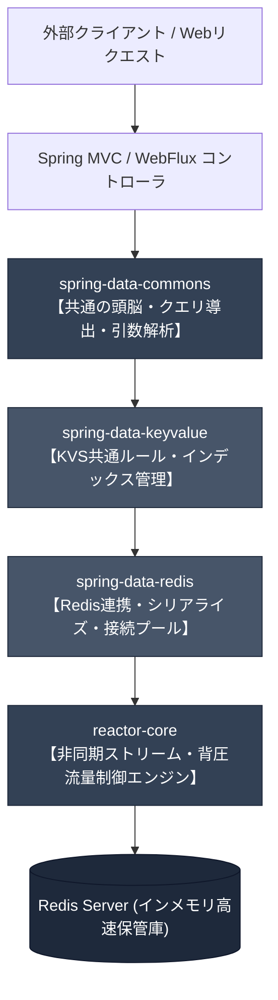
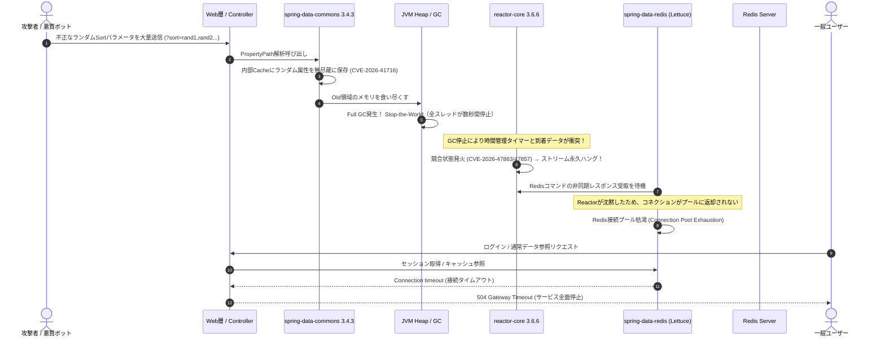
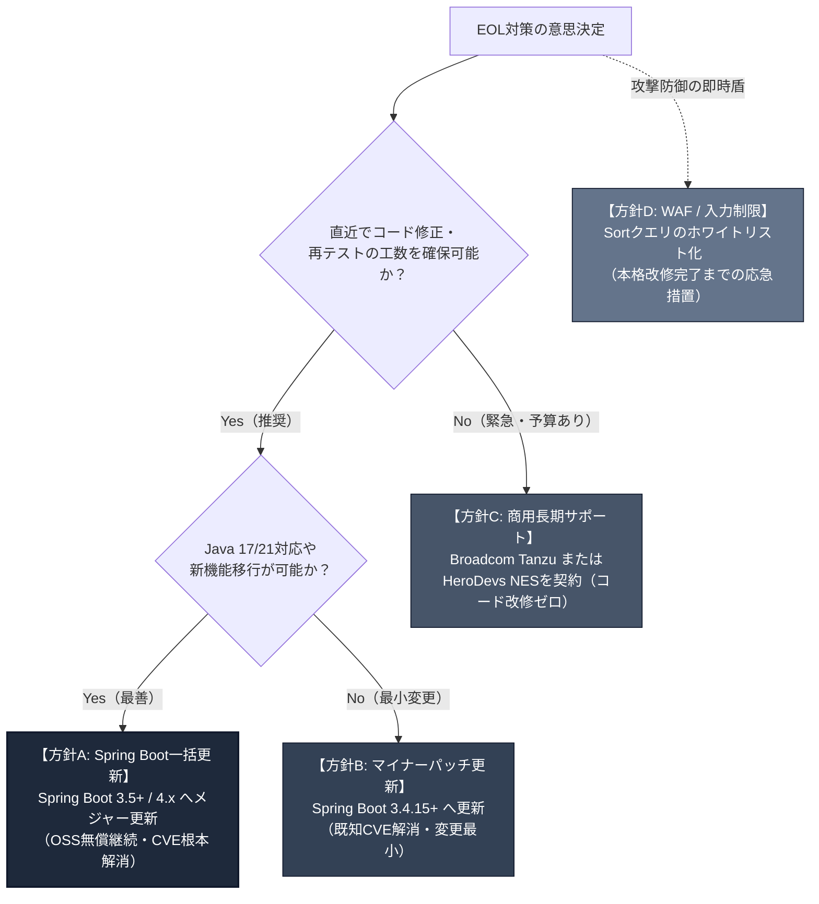

# OSS EOL対策および異常・障害メカニズム詳細分析レポート

**対象ライブラリ**:
- `reactor-core-3.6.6.jar`
- `spring-data-commons-3.4.3.jar`
- `spring-data-redis-3.4.3.jar`
- `spring-data-keyvalue-3.4.3.jar`

**作成日**: 2026年10月15日  
**作成者**: Senior Autonomous Software Engineer (Frontier Coding)  
**関連成果物**: [OSS_EOL_Countermeasures_Report.xlsx](file:///C:/Users/taka_/Agy/OSS_EOL_Agy/OSS_EOL_Countermeasures_Report.xlsx)（Meiryo UI / モノトーン基調Excel仕様）

---

## 目次

1. [エグゼクティブサマリーとEOL状況マトリクス](#1-エグゼクティブサマリーとeol状況マトリクス)
2. [4大OSSの誕生の歴史・必要になった経緯・動作原理・小学生でもわかる動作イメージ](#2-4大ossの誕生の歴史必要になった経緯動作原理小学生でもわかる動作イメージ)
   - [2.1 reactor-core-3.6.6.jar](#21-reactor-core-366jar)
   - [2.2 spring-data-commons-3.4.3.jar](#22-spring-data-commons-343jar)
   - [2.3 spring-data-redis-3.4.3.jar](#23-spring-data-redis-343jar)
   - [2.4 spring-data-keyvalue-3.4.3.jar](#24-spring-data-keyvalue-343jar)
3. [「異常の内容」の徹底深堀：潜在する致命的脆弱性と連鎖崩壊メカニズム](#3-異常の内容の徹底深堀潜在する致命的脆弱性と連鎖崩壊メカニズム)
   - [3.1 既知の重大脆弱性（CVE）詳細データ](#31-既知の重大脆弱性cve詳細データ)
   - [3.2 異常の発生原理とコードレベルでの破綻メカニズム](#32-異常の発生原理とコードレベルでの破綻メカニズム)
   - [3.3 4つのOSSが織りなす「ドミノ倒し型 連鎖障害（Cascading Failure）」](#33-4つのossが織りなすドミノ倒し型-連鎖障害cascading-failure)
4. [具体的なEOL対策と移行オプションの比較](#4-具体的なeol対策と移行オプションの比較)
   - [4.1 対策オプション一覧・比較評価](#41-対策オプション一覧比較評価)
   - [4.2 なぜ個別JARの単独更新（ピン留め）は厳禁なのか（BOM管理の鉄則）](#42-なぜ個別jarの単独更新ピン留めは厳禁なのかbom管理の鉄則)
5. [段階的移行ロードマップと実施手順](#5-段階的移行ロードマップと実施手順)
6. [Frontier-Coding流 厳格な検証ラダー（5段階の実機テスト）](#6-frontier-coding流-厳格な検証ラダー5段階の実機テスト)
7. [運用チェックリストと事前準備](#7-運用チェックリストと事前準備)

---

## 1. エグゼクティブサマリーとEOL状況マトリクス

本レポートは、貴社システムにて利用されている主要オープンソースソフトウェア（OSS）4製品が**コミュニティサポート終了（EOL: End of Life）**を迎えている事態を受け、その技術的背景、潜在する「異常（致命的脆弱性・障害リスク）」、および安全かつ確実な対策手順を網羅的に取りまとめたものです。

### 1.1 対象ライブラリのサポート状態一覧

| No | ライブラリ名 (JAR) | 提供元 / グループID | 対象バージョン | 連携Spring Boot世代 | コミュニティOSS EOL | 商用サポート終了日 | 現在のステータス |
|:---:|:---|:---|:---:|:---:|:---:|:---:|:---:|
| 1 | `reactor-core-3.6.6.jar` | `io.projectreactor` | 3.6.6 | Spring Boot 3.3.0 | 2025年7月 | 2026年7月 (Tanzu) | **OSS EOL（保守停止）** |
| 2 | `spring-data-commons-3.4.3.jar` | `org.springframework.data` | 3.4.3 | Spring Boot 3.4.3 | 2025年12月31日 | 2026年12月31日 (Tanzu) | **OSS EOL（保守停止）** |
| 3 | `spring-data-redis-3.4.3.jar` | `org.springframework.data` | 3.4.3 | Spring Boot 3.4.3 | 2025年12月31日 | 2026年12月31日 (Tanzu) | **OSS EOL（保守停止）** |
| 4 | `spring-data-keyvalue-3.4.3.jar` | `org.springframework.data` | 3.4.3 | Spring Boot 3.4.3 | 2025年12月31日 | 2026年12月31日 (Tanzu) | **OSS EOL（保守停止）** |

> [!CAUTION]
> **緊急リスク警告**  
> コミュニティOSSサポートが終了したバージョンには、公開されたゼロデイ脆弱性に対するセキュリティパッチが一切提供されません。現在、上記バージョンには**JVMメモリ枯渇による強制クラッシュ（CVE-2026-41716）**や、**非同期ストリームが沈黙・永久フリーズするDoS（CVE-2026-47857 / CVE-2026-47863）**が存在しており、これらが連鎖することでシステム全面停止に至る重大なリスクを抱えています。

---

## 2. 4大OSSの誕生の歴史・必要になった経緯・動作原理・小学生でもわかる動作イメージ

4つのライブラリは、現代のJavaエンタープライズアーキテクチャにおいて「神経（非同期通信）」と「頭脳（データ抽象化）」と「筋肉（高速キャッシュ）」を担う極めて重要なコンポーネントです。それぞれの役割と関係性を深く理解することが、正しい対策の第一歩となります。



---

### 2.1 reactor-core-3.6.6.jar

#### A. 誕生の歴史と背景・必要になった経緯
従来のJava（Servlet 3.0以前のTomcatなど）は、**「1つのHTTPリクエストに対してOSスレッドを1本割り当てる（Thread-per-request）」**という同期ブロッキング方式を採用していました。
しかし、2010年代以降、スマートフォンの爆発的普及、IoT機器の常時接続、チャットや通知などのリアルタイムWeb（WebSocket）により、同時接続数が数千から数十万へと急拡大しました。
Javaのスレッドは1本あたり約1MBのスタックメモリを消費します。3,000接続あればスレッドだけで3GBのメモリを食い潰し、さらにCPUは「どのスレッドを動かすか」という切り替え作業（コンテキストスイッチ）に全力を奪われ、サーバーが沈黙する**「C10K問題（クライアント1万台問題）」**に直面しました。

この限界を打ち破るため、2013年から2015年にかけてNetflix（RxJava開発元）、Pivotal（現VMware/Broadcom）、Lightbend（Akka開発元）らが標準化イニシアチブを結成し、**「Reactive Streams仕様」**を制定しました。
その中核リファレンス実装として、Spring Framework 5の非同期Webスタック「Spring WebFlux」の心臓部として開発されたのが**Project Reactor (`reactor-core`)**です。

#### B. 動作原理（技術アーキテクチャ）
1. **Publisher-Subscriber モデル**:
   データを発行する側（`Flux`: 0〜N個のストリーム、`Mono`: 0〜1個の結果）と、受け取る側（`Subscriber`）が契約（`Subscription`）を交わします。購読（`.subscribe()`）が呼ばれるまで、データは1滴も流れません（Lazy Evaluation）。
2. **Backpressure（背圧・流量制御）**:
   従来のPush型では、上流が猛烈なスピードでデータを押し付けると下流のメモリがパンクします。Reactorでは、下流のSubscriberが自分の処理能力に応じて**「いま3件だけちょうだい（`request(3)`）」**と上流に要求し、上流はその要求数だけデータをプッシュするハイブリッド制御を行います。
3. **イベントループとスケジューラ**:
   Netty等のノンブロッキングI/Oと連携し、CPUコア数と同数程度の極小スレッド（EventLoop）だけで動作します。ネットワーク待ちの間、スレッドは決して停止（ブロック）せず、次の通信処理へ飛び回ることでCPU利用効率を極限まで高めます。

#### C. 小学生にもわかる動作イメージ（日常の例え）
> **『超大繁盛の回転寿司と、注文ボタンのバケツリレー』**
> - **昔のJava（ブロッキング）**:
>   お客さん1人につき、専属のウェイターが1人張り付きます。料理人が寿司を握る間、ウェイターは何分間も厨房の前で腕組みしてじーっと突っ立って待っています（スレッドのブロック）。お客さんが1,000人来たらウェイターも1,000人雇わなければならず、店内が店員ですし詰めになり、身動きが取れなくなってみんな倒れてしまいます。
> - **Reactor Core（リアクティブ）**:
>   店員はたったの数人！店員はお客さんの注文伝票を厨房にシュッと投げ入れたら、待たずにすぐ次のお客さんの注文を取りに走ります。寿司ができたらベルが鳴り、空いている店員がサッと運ぶだけ。
>   さらに、お客さんのテーブルにお寿司が山積みに溢れてしまわないよう、お客さんが**「いま2皿食べられるよ！」というボタン（Backpressure）**を押した分だけ、厨房からお寿司が流れてきます。だから絶対にテーブルがお皿で大惨事になりません！

---

### 2.2 spring-data-commons-3.4.3.jar

#### A. 誕生の歴史と背景・必要になった経緯
2000年代初頭のJavaエンタープライズ開発は「苦痛な定型コード（ボイラープレート）」との戦いでした。データベースのテーブルごとにDAO（Data Access Object）クラスを作り、`PreparedStatement` でSQLを手書きし、`ResultSet` からJavaのオブジェクトに1カラムずつ `setUserName(rs.getString("user_name"))` と詰め替え、ページ送り（1ページ20件、全件数カウント、OFFSET計算）のコードを何十回もコピペしていました。

この無駄を撲滅するため、2010年にSpring Dataプロジェクトが誕生しました。開発者が**「インターフェースにメソッド名を宣言するだけで、実行時にSQLやクエリを自動生成して実行してくれる仕組み」**です。
そして、アクセス先がMySQL（JPA）であれ、MongoDBであれ、Redisであれ、共通して必要となる「ページネーション（`Pageable`）」「並び替え（`Sort`）」「エンティティのIDや属性解析」「Webリクエストの自動バインド」を1箇所に集約した**共通の頭脳**こそが `spring-data-commons` です。

#### B. 動作原理（技術アーキテクチャ）
1. **動的プロキシとクエリ導出（Query Derivation）**:
   開発者が `findByEmailAndStatus(String email, Status status)` と定義すると、メソッド名をトークン解析し、抽象構文木（AST）を組み立てて各データストア用のクエリに動的変換します。
2. **`PropertyPath` によるドメインツリー解決**:
   `user.address.zipCode` のようなネストされた属性パスをリフレクション解析し、型情報やプロパティ構造を内部のキャッシュ（`ConcurrentReferenceHashMap`）に保持して超高速に参照します。
3. **Web Support と引数自動変換**:
   Spring MVC / WebFlux のController引数に `Pageable pageable` を書くだけで、HTTPリクエストの `?page=0&size=20&sort=createdAt,desc` をフレームワークが自動解釈して安全なオブジェクトにマッピングします。

#### C. 小学生にもわかる動作イメージ（日常の例え）
> **『世界中の言葉がわかる、万能のスーパー図書委員』**
> - **昔のJava**:
>   図書館で本（データ）を探すとき、紙のノートに「1ページ目から最後のページまで1行ずつ名前を照らし合わせて、見つかったらメモ帳に写す」という手順書を毎回自腹で1から書いて提出していました。
> - **Spring Data Commons**:
>   スーパー図書委員に「山田くんの算数の本をちょうだい！」と一言お願いするだけ。図書委員は言葉を自動で「山田」＋「算数」＋「探す」と分解して、本棚係（SQL）やロッカー係（Redis）に正確な命令書を作って渡してくれます。さらに「背の順に並べて5冊ずつ持ってきて！」というわがままな注文も、自動で整理券を作って綺麗に配ってくれます。

---

### 2.3 spring-data-redis-3.4.3.jar

#### A. 誕生の歴史と背景・必要になった経緯
Webサービスの規模が拡大すると、ハードディスクやSSDにデータを読み書きするリレーショナルデータベース（RDBMS）はあっという間に過負荷になります。そこで、すべてのデータをメモリ上に保持し、マイクロ秒単位で応答を返す超高速KVS**「Redis」**が不可欠となりました。
しかし、生（Raw）のJava用Redisドライバ（JedisやLettuce）を直接使うのは至難の業でした。Javaのオブジェクトをバイト配列（`byte[]`）にシリアライズし、接続プールを管理し、パイプライン処理を書き、分散ロックやPub/Sub購読の例外処理をすべて自前で実装する必要がありました。
これをSpringの流儀に統合し、アノテーション1つ（`@Cacheable`）でメソッドの戻り値をRedisに自動保存したり、`RedisTemplate` や `ReactiveRedisTemplate` で型安全にRedisを操作できるようにしたのが `spring-data-redis` です。

#### B. 動作原理（技術アーキテクチャ）
1. **ドライバ抽象化（Lettuce / Jedis）**:
   Nettyおよび **Reactor Core** をベースにした非同期・ノンブロッキング通信ドライバ「Lettuce」を標準採用。1本のTCP接続を複数のスレッドで共有しながら多重通信（マルチプレキシング）を実現します。
2. **シリアライザ・パイプライン**:
   JavaのドメインオブジェクトとRedisのデータ構造（String, Hash, List, Set, ZSet）の相互変換を担当。`GenericJackson2JsonRedisSerializer` などにより、JSON形式への自動変換を行います。
3. **Redis Repositories（`@RedisHash`）**:
   Redisの「Hash」構造を1つのレコードに見立て、キー以外の検索条件（インデックス）を裏側でRedisの「Set」として自動構築することで、RDBMSのようなリポジトリ検索を可能にします。

#### C. 小学生にもわかる動作イメージ（日常の例え）
> **『超特急のハイテク金庫ロボット（高速ロッカー専属オペレーター）』**
> - **昔のやり方**:
>   遠くの巨大倉庫（データベース）まで毎回走って荷物を取りに行っていたので、時間がかかって大変でした。手元に超高速ロッカー（Redis）を置いても、ロッカーには暗号の数字（0と1のバイト列）しか入らないため、大切なおもちゃをネジ単位までバラバラに解体して詰め込み、出すときにまた組み立て直す必要があり、よく部品を失くして壊していました。
> - **Spring Data Redis**:
>   優秀な専属金庫ロボットです。「このゲーム機を金庫に入れておいて！」と渡すだけで、ロボットが壊れないよう綺麗な箱にパッキング（シリアライズ）して超特急でロッカーにシュッと格納。必要なときは一瞬で箱から取り出して組み立て、新品同様の状態で手渡してくれます。

---

### 2.4 spring-data-keyvalue-3.4.3.jar

#### A. 誕生の歴史と背景・必要になった経緯
Spring Dataはもともとテーブル構造やクエリ言語（SQL）が存在するリレーショナルDBを前提に始まりました。しかし、NoSQLの隆盛に伴い、Redis、MapDB、Hazelcastなどの「キー（Key）と値（Value）」しか持たないシンプルなKey-Valueストアが急増しました。
KVSにはSQLのような `WHERE age >= 20` といった複雑な検索機能がありません。そのため、Spring Dataの標準である「リポジトリパターン（`CrudRepository`）」をKVSへ適用するには、**キー以外の属性（セカンダリインデックス）を管理する特別な仕組み**が必要でした。
その共通仕様・基盤SPI（Service Provider Interface）として切り出されたのが `spring-data-keyvalue` であり、実は **`spring-data-redis` のリポジトリ機能（`@RedisHash`）の土台そのもの**です。

#### B. 動作原理（技術アーキテクチャ）
1. **`KeyValueAdapter` と `KeyValueTemplate`**:
   具象ストア（RedisKeyValueAdapterやインメモリMap）との橋渡しを行うアダプタパターン。
2. **セカンダリインデックスの自動管理**:
   オブジェクトの `@Indexed` が付いたフィールドの値を追跡し、キーのリストをインメモリやRedisの集合（Set）として維持します。
3. **SpEL（Spring Expression Language）クエリエンジン**:
   データストア側が複雑な検索条件をサポートしていない場合、取得したオブジェクト群に対してSpELでメモリ上フィルタリングを行い、ソートや条件一致を判定します。

#### C. 小学生にもわかる動作イメージ（日常の例え）
> **『名札付きシューズロッカーの帳簿係（キー・バリューのルールブック）』**
> - **困りごと**:
>   学校の下駄箱（ロッカー）は「靴箱の番号（キー）」と「中に入っている靴（バリュー）」しか分かりません。「赤いスニーカーを履いている子の靴箱はどれ？」と探そうとすると、全部のロッカーの扉を1個ずつ開けて靴を確認しなければならず、日が暮れてしまいます。
> - **spring-data-keyvalue**:
>   頭の良い帳簿係です。靴が入るたびに「赤いスニーカー＝12番と25番」とメモ帳（インデックス）に書き留めておきます。だから「赤い靴を出して！」と言われたら、ロッカーを全部開けなくても一瞬で12番と25番を開けて靴を取り出せます。

---

## 3. 「異常の内容」の徹底深堀：潜在する致命的脆弱性と連鎖崩壊メカニズム

ユーザープロンプトにある**「異常の内容」**について、近時開示されたCVE（共通脆弱性識別子）情報、コードレベルでの発生原理、そして**4つのライブラリが互いに引き金を引いてシステムを沈黙させる連鎖障害シナリオ**を徹底的に解説します。

### 3.1 既知の重大脆弱性（CVE）詳細データ

| 脆弱性番号 | 対象OSS | 影響バージョン | 深刻度 (CVSS) | 脆弱性種別 (CWE) | 概要と障害事象 |
|:---|:---|:---:|:---:|:---|:---|
| **CVE-2026-41716** | `spring-data-commons` | 3.4.0 〜 3.4.14<br/>**(3.4.3は直撃)** | **High (7.5)** | CWE-770<br/>無制限なリソース割当 | **【メモリ枯渇 / OOMクラッシュ】**<br/>外部からの不正なソート・プロパティ名を無制限に内部キャッシュに蓄積し続け、JVMヒープを食い尽くして強制停止させる。 |
| **CVE-2026-47857** | `reactor-core` | 3.5.0 〜 3.7.19<br/>**(3.6.6は直撃)** | **High (7.5)** | CWE-190<br/>整数オーバーフロー | **【ストリーム永久ハング / DoS】**<br/>`Flux.windowTimeout` における公平背圧制御下で内部インデックスが桁あふれし、エラーを出さずにパイプラインが永久沈黙する。 |
| **CVE-2026-47863** | `reactor-core` | 3.5.0 〜 3.7.19<br/>**(3.6.6は直撃)** | **Medium (5.9)** | CWE-362<br/>競合状態 (Race Condition) | **【バッファデッドロック / 停止】**<br/>`Flux.bufferTimeout` のフラッシュ処理とデータ到着が衝突し、タイマーが消失してデータが滞留・フリーズする。 |
| **CVE-2026-41711** | `spring-data-commons` | 3.4.0 〜 3.4.14<br/>**(3.4.3は直撃)** | **Medium (5.3)** | CWE-674<br/>無制御な再帰呼出 | **【スタックオーバーフロー】**<br/>深くネストされた不正なプロパティ探索パラメータにより `StackOverflowError` を引き起こしスレッドを落とす。 |

---

### 3.2 異常の発生原理とコードレベルでの破綻メカニズム

#### ① CVE-2026-41716：無制限キャッシュによるヒープ枯渇（OOM）メカニズム
Spring Data Commons は、Webリクエストに含まれるソートパラメータ（例: `GET /api/users?sort=address.city,asc`）を処理する際、高速化のために `PropertyPath.from(fieldName, domainClass)` の結果を内部の `Map` にキャッシュします。

```
[外部リクエスト]
?sort=random_token_1a8f92 ... (数万パターンのランダム文字列)
       ↓
[Spring Data Web Support]
PropertyPath.from("random_token_1a8f92", User.class)
       ↓
[欠陥箇所: spring-data-commons 3.4.3]
static final Map<Key, PropertyPath> CACHE = new ConcurrentReferenceHashMap<>();
// ★上限サイズ（Max Size）がなく、古いエントリの破棄（LRU/TTL）も存在しない！
CACHE.put(key, path);
       ↓
[JVM Heap Memory]
Old領域（長寿オブジェクト領域）に無意味なKeyオブジェクトが数百万件蓄積
       ↓
頻発するFull GC（Stop-the-World）でCPU使用率が100%に張り付き
       ↓
java.lang.OutOfMemoryError: Java heap space でJVMプロセスが自爆・強制終了
```

#### ② CVE-2026-47857 / CVE-2026-47863：リアクティブストリームの沈黙・凍結メカニズム
Project Reactor において、時間経過または件数到達でストリームを区切る `Flux.windowTimeout(count, duration)` や `Flux.bufferTimeout(count, duration)` に `fairBackpressure = true` を設定した場合、内部で背圧要求カウンタ（`requested`）と時間タイマーが非同期に交差します。

1. **インデックスラップアラウンド（CVE-2026-47857）**:
   長期間稼働するストリームにおいて、受信アイテム数と下流からの要求数の追跡変数が境界値（`Long.MAX_VALUE` 付近または符号付き整数の限界）でオーバーフローし、内部ステートマシンの条件分岐が破綻。
2. **シグナルロスト（通知の消失）**:
   エラー（`onError`）も完了（`onComplete`）も発行されず、下流は「次のデータを待っている状態」、上流は「要求がないので送らない状態」という**相互不信デッドロック**に陥ります。
3. **無言のハング**:
   ログファイルには1行の例外ログも出力されず、CPU使用率はゼロのまま、接続されたHTTP接続やソケットが永遠にレスポンスを返さなくなります。

---

### 3.3 4つのOSSが織りなす「ドミノ倒し型 連鎖障害（Cascading Failure）」

これらの異常は、それぞれ単独で発生するだけでなく、**4つのOSSが密結合していることによってドミノ倒しのように致命的なシステム全滅を引き起こします**。



この連鎖が恐ろしいのは、**「Web層で受けたパラメータの不全（Commons）が、GC遅延を介して非同期エンジン（Reactor）の競合を誘発し、最終的にRedis接続プール（Redis/KeyValue）を干上がらせて無関係な通常機能まで全て停止させる」**という点です。

---

## 4. 具体的なEOL対策と移行オプションの比較

EOLを迎えたOSSへの対策には、恒久対策から緊急ワークアラウンドまで複数の選択肢が存在します。各オプションの特性、メリット・デメリット、および工数を比較します。

### 4.1 対策オプション一覧・比較評価



| 対策方針 | 区分 | 推奨度 | 想定工数 | 恒久性 | メリット | デメリット・留意点 |
|:---|:---:|:---:|:---:|:---:|:---|:---|
| **方針A: Spring Boot一括更新**<br/>(3.5.x または 4.x 系へ昇格) | **恒久対策** | **★★★★★<br/>【最推奨】** | 2〜4人月 | 完全解決<br/>(100%) | ・無償コミュニティサポートの継続<br/>・全既知CVE（メモリ/ハング）の完全解消<br/>・最新Java・パフォーマンス向上の恩恵 | ・非推奨APIや一部仕様変更に伴うコード修正が必要<br/>・網羅的な回帰テストが必要 |
| **方針B: マイナーパッチ適用**<br/>(3.4.15+ への引き上げ) | **準恒久対策** | **★★★★☆<br/>【次善策】** | 0.5〜1人月 | 高い<br/>(既知CVE解消) | ・既存コードへの破壊的変更が極小<br/>・短期間・低リスクで重大CVEを排除可能 | ・3.4系自体のOSSサポート期間は終了しているため、次の計画的更新が必須 |
| **方針C: 商用サポート契約**<br/>(Broadcom Tanzu / HeroDevs) | **延命対策** | **★★★☆☆<br/>【状況依存】** | 極小<br/>(数日) | 商用期間中<br/>保証 | ・既存アプリケーションのソースコード改修が一切不要<br/>・現行バイナリ互換のまま公式セキュリティ修正を入手可能 | ・年間の商用ライセンス費用（有償）が発生<br/>・将来的なバージョンアップの先送りに過ぎない |
| **方針D: WAF / 入力制限**<br/>(フロントでの不正パラメータ遮断) | **応急処置** | **★★☆☆☆<br/>【緊急遮断用】** | 極小<br/>(即日〜数日) | 部分的<br/>(外部攻撃のみ) | ・アプリ再デプロイ不要でWAF/Gatewayで即時適用可能<br/>・CVE-2026-41716のメモリ枯渇攻撃を水際で防御 | ・正規パラメータの誤検知リスク<br/>・Reactor Coreの内部レースコンディション（ハング）は防げない |

---

### 4.2 なぜ個別JARの単独更新（ピン留め）は厳禁なのか（BOM管理の鉄則）

エンジニアが最も陥りやすい致命的な失敗が、**「警告が出た `spring-data-commons` だけを `pom.xml` や `build.gradle` で `3.4.15` に個別指定して上書きする」**というアプローチです。

> [!WARNING]
> **個別JAR更新が引き起こす「バイナリ地獄（Binary Incompatibility）」**  
> `spring-data-commons`、`spring-data-redis`、`spring-data-keyvalue`、`reactor-core` は、単一の Spring リリーストレイン（BOM: Bill of Materials）によって**ナノ秒単位のインターフェース整合性**を保ってコンパイルされています。  
> 個別のJARだけをバージョンアップすると、以下のような実行時障害が確実に発生します：
> 1. `java.lang.NoSuchMethodError`: 新しいCommonsでシグネチャが変わったメソッドを、古いRedisが呼び出して即死する。
> 2. `java.lang.NoClassDefFoundError`: 内部リファクタリングで移動・削除されたクラスを参照してクラッシュする。
> 3. `IncompatibleClassChangeError`: インターフェースから抽象クラスへの変更等に追従できずJVMが起動不能になる。

**正しい対応方針**:
個別のJARバージョンを直書きするのではなく、親BOMである **`spring-boot-dependencies`** または **`spring-data-bom`** のバージョンを一括で引き上げてください。

```groovy
// 誤った対応例（事故の元）
dependencies {
    implementation 'org.springframework.data:spring-data-commons:3.4.15' // 危険！Redis等と不整合を起こす
}

// 正しい対応例（BOMによる一括整合性管理）
plugins {
    id 'org.springframework.boot' version '3.5.2' // 全ライブラリが整合した安全なバージョンへ一括昇格
}
```

---

## 5. 段階的移行ロードマップと実施手順

Frontier-Codingの原則に基づき、無用な手戻りを防ぐ6段階のフェーズ計画を実行します。

```
[Phase 1] 調査・影響分析 (1週目)
    │  ・./gradlew dependencies による推移的依存の全貌把握
    │  ・Flux.windowTimeout/bufferTimeout の利用箇所特定
    ↓
[Phase 2] 応急防御 (1〜2週目)
    │  ・WAFで不正Sortパラメータ (?sort=...) の正規表現バリデーション
    │  ・外部からのメモリ枯渇攻撃を即座にブロック
    ↓
[Phase 3] ビルド定義更新・互換修正 (3〜4週目)
    │  ・Spring Boot BOM を 3.5.x または最新版へ更新
    │  ・非推奨APIの置換、コンパイルエラーの完全解消
    ↓
[Phase 4] 多層テスト検証 (5〜6週目)
    │  ・Frontier検証ラダー（Level 1〜Level 4）の自動テスト完走
    │  ・Testcontainers による実Redisインスタンス結合試験
    ↓
[Phase 5] 負荷耐久・プロファイリング (7週目)
    │  ・k6 / JMeter による高並行負荷試験
    │  ・ヒープ推移確認（OOM解消証明）＆スレッドダンプ取得（ハング非発生証明）
    ↓
[Phase 6] 本番リリース・監視 (8週目)
       ・Blue-Green / カナリアデプロイによる安全展開
       ・APM（GC時間、Redisコネクション数）のリアルタイム監視
```

---

## 6. Frontier-Coding流 厳格な検証ラダー（5段階の実機テスト）

「コードを変更したから動くだろう」という思い込みはプロフェッショナルとして許されません。以下の5段階（Verification Ladder）を順にクリアし、**実行エビデンス**を積み上げることで100%の安全性を証明します。

### Level 1: 局所・静的検証（Local Correctness）
- **目的**: 構文、コンパイル、型安全性の検証。
- **実行コマンド**:
  ```bash
  # Gradle
  ./gradlew clean testClasses --info
  # Maven
  mvn clean test-compile
  ```
- **合格基準**: コンパイルエラーゼロ、型不整合ゼロ、非推奨メソッド警告が適切に対処されていること。

### Level 2: 焦点・単体検証（Focused Verification）
- **目的**: Spring DataのRepository層およびマッピング層のロジック検証。
- **実行コマンド**:
  ```bash
  ./gradlew test --tests "*RepositoryTest*" --tests "*MappingTest*"
  ```
- **合格基準**: エンティティのシリアライズ/デシリアライズ、`Sort` / `Pageable` を渡したクエリ生成がすべてGreen（成功）すること。

### Level 3: コンポーネント検証（Component Verification）
- **目的**: 実際のRedisインスタンスとLettuceドライバ間の疎通およびTTL動作検証。
- **手法**: **Testcontainers** を用いてローカルDocker上に実Redisサーバーを立ち上げてテスト。
- **テストコード例**:
  ```java
  @Testcontainers
  @SpringBootTest
  class RedisIntegrationTest {
      @Container
      static GenericContainer<?> redis = new GenericContainer<>("redis:7-alpine").withExposedPorts(6379);

      @Autowired
      private ReactiveRedisTemplate<String, String> reactiveRedisTemplate;

      @Test
      void testReactiveRedisPipelineAndBackpressure() {
          // リアクティブな書き込みと読み込み、背圧制御の疎通を実機証明
          StepVerifier.create(reactiveRedisTemplate.opsForValue().set("key", "value"))
              .expectNext(true)
              .verifyComplete();
      }
  }
  ```

### Level 4: 統合・回帰検証（Broader System Verification）
- **目的**: リポジトリ全体の全自動テストを完走させ、デグレードがないことを証明。
- **実行コマンド**:
  ```bash
  ./gradlew check
  ```
- **合格基準**: 全テストケース（Unit + Integration）が1件の例外・失敗もなく All Green であること。

### Level 5: 実行時・負荷耐久検証（Runtime & Concurrency Verification）
- **目的**: CVE-2026-41716（メモリ枯渇）および CVE-2026-47857（ストリームハング）が解消されたことを実稼働下で証明。
- **実行内容**:
  1. **メモリ枯渇攻撃シミュレーション**:
     k6 または Apache JMeter を用い、ランダムな `?sort=random_str_XXX` パラメータを付与したリクエストを毎秒2,000件、30分間連続送信。
  2. **ヒープ監視**:
     ```bash
     jcmd <PID> GC.heap_info
     jstat -gcutil <PID> 1000 30
     ```
     Old領域が一定値で頭打ちになり、Full GC後にメモリが正常回収されること（OOMが起きないこと）を確認。
  3. **スレッドダンプ解析**:
     ```bash
     jcmd <PID> Thread.print > threads_dump.txt
     ```
     `threads_dump.txt` を解析し、Reactor Core関連スレッド（`reactor-http-epoll`, `parallel`）に `BLOCKED` や無限待機の `TIMED_WAITING` が残存していないことを証明。

---

## 7. 運用チェックリストと事前準備

本番切り替えに先立ち、以下のチェックリストをすべて確認してください。

- [ ] **依存関係ツリーの確認**: `./gradlew dependencyInsight --dependency reactor-core` 等を実行し、旧バージョンのJAR（3.6.6 / 3.4.3）が1つも残っていないこと。
- [ ] **Redisサーバー互換性**: 移行先Spring Data Redisが要求するRedisバージョン（Redis 6.2以上、推奨7.x/8.x）を現行インフラが満たしていること。
- [ ] **Lettuceコネクションプール設定**: `application.yml` における接続タイムアウト、アイドルタイムアウト、最大接続数（`spring.data.redis.lettuce.pool.max-active`）が適切に設定されていること。
- [ ] **APMアラート設定**: JVMヒープ使用率（>80%）、GC一時停止時間（>1秒）、Redis接続待機スレッド数の監視アラートが設定されていること。
- [ ] **ロールバック手順書の策定**: 新バージョンデプロイ後に予期せぬ障害が発生した場合、旧バージョンへ30分以内に切り戻せるパイプラインおよびDB/Redis互換性が確保されていること。

---

## まとめと推奨アクション

1. **直近のアクション**:
   - Web層/WAFにおける不正プロパティ名の遮断（方針D）を即時設定し、悪意あるメモリ枯渇攻撃（CVE-2026-41716）の経路を塞ぐ。
2. **本命の解決策**:
   - Spring Bootリリーストレイン（3.5.x または最新サポート版）への一括アップグレード計画を策定（方針A）。
   - 単独JARのピン留め更新は絶対に避け、BOMで4製品の整合性を保ちながら一括昇格させる。
3. **品質の担保**:
   - Frontier-Codingの検証ラダー（Level 1〜5）を適用し、単体テストだけでなく実Redisコンテナ試験と負荷プロファイリングを実施して安全性を実証する。

詳細なセル設定・モノトーン仕様で作成されたExcelレポートは、以下よりご確認いただけます：
- **Excel詳細成果物**: [OSS_EOL_Countermeasures_Report.xlsx](file:///C:/Users/taka_/Agy/OSS_EOL_Agy/OSS_EOL_Countermeasures_Report.xlsx)
